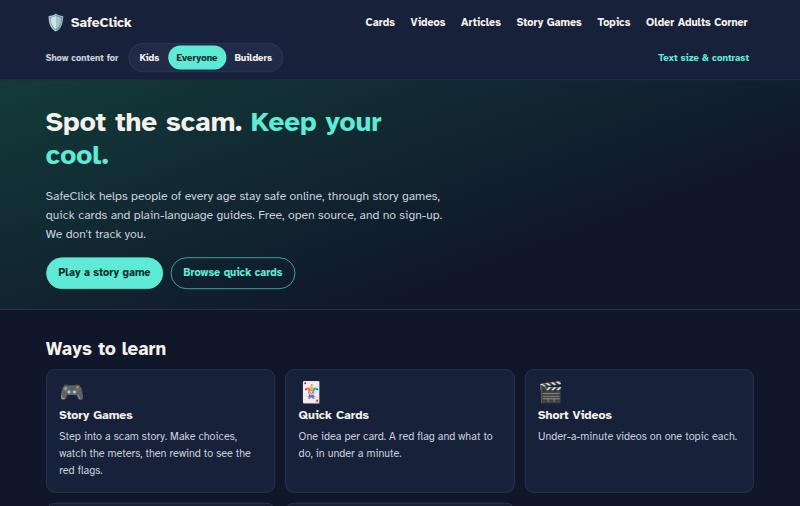
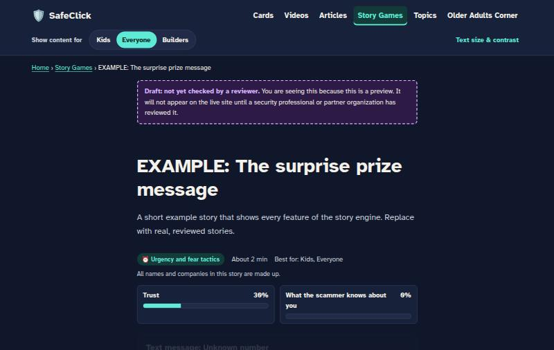
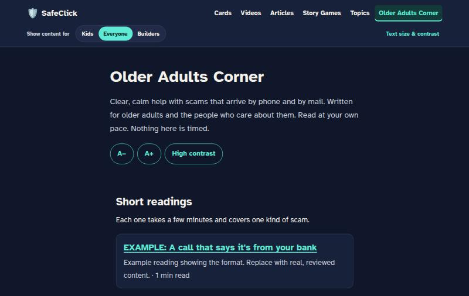

# SafeClick

**Spot the scam. Keep your cool. Stay safe online.**

SafeClick is a free, open source website that teaches people of every age how to stay safe online and avoid scams: phishing, scam texts and calls, passwords, two-factor authentication, public Wi-Fi, privacy and more. It's built to feel like play, not a lecture.

- 🎮 **Story games.** Step into a scam story, make choices, watch the *Trust* and *What the scammer knows about you* meters move, then hit **Rewind** to see the red flags you missed and what to do instead.
- 🕹️ **Neon City (arcade platformer).** A Phaser platformer where you run, jump and spot safe vs. unsafe links across three levels, a boss and a Scam Files screen. It is a draft: hidden from the production build and the Games page, and only visible in `npm run dev` and `npm run build:preview`.
- 🃏 **Quick cards.** One idea, one red flag, one thing to do.
- 🎬 **Short videos** and 📖 **articles** for the full picture.
- ☕ **Older Adults Corner.** Calm, plain-language readings, gentle quizzes and printable one-page handouts about phone and mail scams.
- 👪 **Kids / Everyone / Builders** switch on every page.

**Privacy by design.** No accounts, no login, no cookies, no analytics, no third-party trackers. Children use this site, so it collects zero personal data. Preferences and game progress live only in the visitor's browser (localStorage). YouTube videos load only after the visitor presses Play.

**Reviewed by experts.** Every piece of content is checked by a security professional or partner organization before it goes live. The production build refuses to publish anything else.

> "SafeClick" is a placeholder name. To rename, edit `src/site.config.ts`, the `name` in `package.json`, and this heading.

## Screenshots



<table>
  <tr>
    <td width="50%"><br><sub>Story game with the Trust and <i>What the scammer knows about you</i> meters (example draft story)</sub></td>
    <td width="50%"><br><sub>Older Adults Corner with text size and contrast controls</sub></td>
  </tr>
</table>

## Run it locally

You need [Node.js](https://nodejs.org/) 22.12 or newer.

```bash
npm install
npm run dev        # http://localhost:4321, shows drafts with a preview banner
```

Other commands:

| Command | What it does |
| --- | --- |
| `npm test` | Runs the unit tests (vitest), including the Neon City game logic |
| `npm run check` | Type-checks the Astro and TypeScript code (`astro check`) |
| `npm run validate` | Checks every content file: story links, unreachable scenes, missing endings, missing Rewind explanations, review fields, no HTML or scripts |
| `npm run build` | Validates, then builds the live site into `dist/`. **Only `reviewed` content is included.** |
| `npm run build:preview` | Same, but includes drafts (with banners). For private staging previews only, never the live site. |
| `npm run preview` | Serves the built `dist/` folder locally |
| `npm run check-links` | First-pass check of every source and help link (some government sites block automated checks, so confirm failures in a browser) |

## How it's organized

```
src/
  site.config.ts          Name, tagline, license, storage keys
  content.config.ts       Content schemas and the review gate
  content/
    concepts/             The topic tags that link everything (phishing, passwords, ...)
    cards/  articles/     Markdown
    videos/  stories/     JSON
    readings/ handouts/   Markdown (Older Adults Corner)
    quizzes/              JSON (Older Adults Corner)
  scripts/story-engine.js The story game engine (vanilla JS, plain text only)
  lib/                    Review gate filter, age-level variants
  pages/                  Routes
scripts/
  validate-content.mjs    Runs before every build
  check-links.mjs
templates/                Copy-and-fill templates for every content type
```

Adding content means adding a file. See [CONTRIBUTING.md](CONTRIBUTING.md).

## Deploy

The site is fully static (`dist/`), so any static host works.

**Cloudflare Pages:** connect the repo, framework preset *Astro*, build command `npm run build`, output directory `dist`, and set the environment variable `NODE_VERSION=22`.

**Vercel:** import the repo. Vercel detects Astro. Build command `npm run build`, output directory `dist`. Set Node.js to 22.x in Project Settings.

**Netlify / GitHub Pages / any web server:** run `npm run build` and upload `dist/`.

Recommended security headers for the live site (set them in your host's headers config, for example `public/_headers` on Cloudflare Pages and Netlify or `vercel.json` on Vercel):

```
Content-Security-Policy: default-src 'self'; script-src 'self' 'unsafe-inline'; style-src 'self' 'unsafe-inline'; img-src 'self' data:; font-src 'self'; frame-src https://www.youtube-nocookie.com; connect-src 'self'; base-uri 'self'; form-action 'none'; frame-ancestors 'none'
Referrer-Policy: no-referrer
X-Content-Type-Options: nosniff
Permissions-Policy: camera=(), microphone=(), geolocation=(), interest-cohort=()
```

A ready-made `public/_headers` file with these is included.

## Licenses

- **Code:** [MIT](LICENSE)
- **Content** (everything in `src/content/`, `templates/`, and the text of the site): [Creative Commons Attribution 4.0 (CC BY 4.0)](CONTENT-LICENSE.md)

## Get involved

You don't need to code to help. Write a story, fact-check a card, translate, or playtest a game. See [CONTRIBUTING.md](CONTRIBUTING.md) and our [Code of Conduct](CODE_OF_CONDUCT.md).
